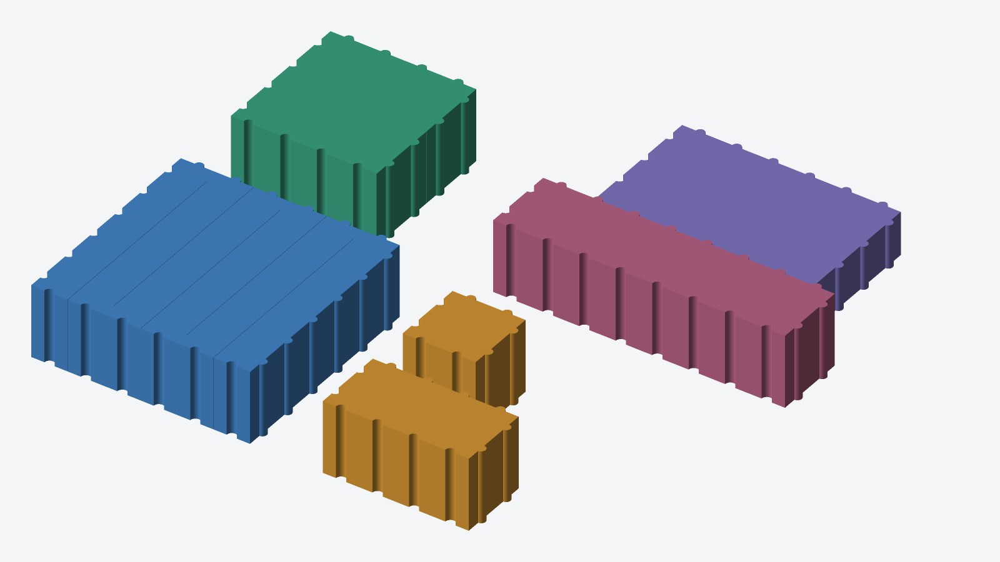
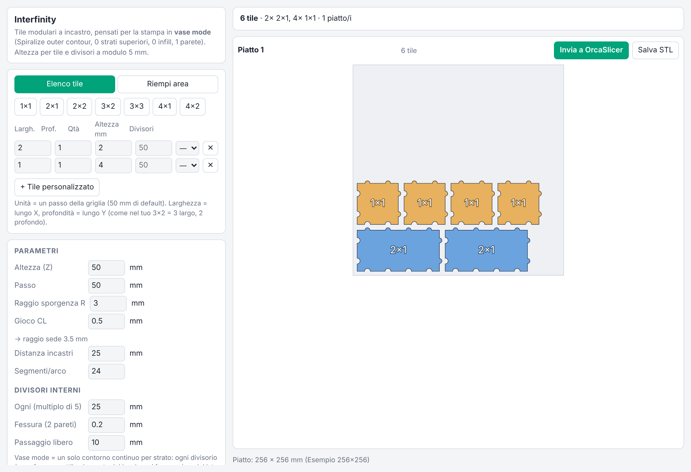
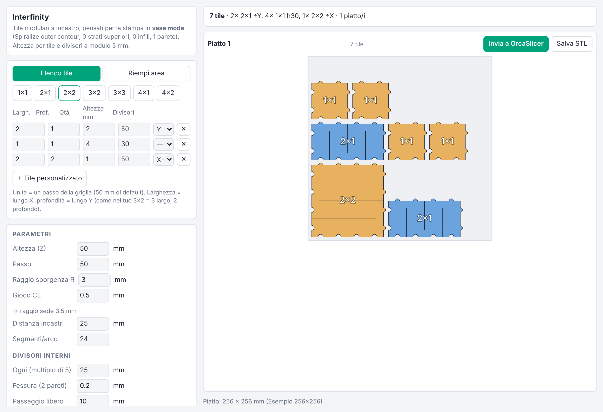
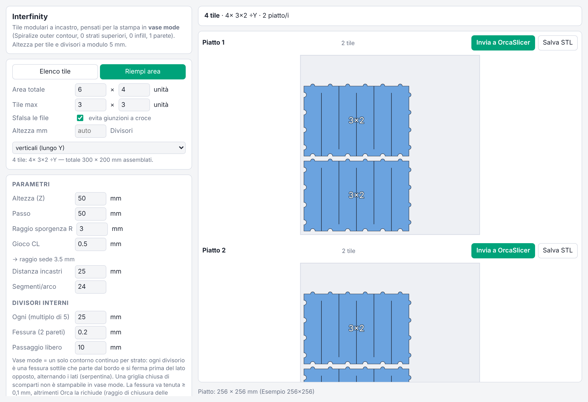

# Interfinity – plugin per OrcaSlicer



Genera i tile modulari **Interfinity** in qualsiasi misura, li impagina sul piatto e li manda direttamente a OrcaSlicer.
Struttura analoga a [Gridfinity-Orca-Plugin](https://github.com/JonasMerrell/Gridfinity-Orca-Plugin) (pannello HTML + plugin Python + invio STL al piatto), ma il codice è riscritto da zero. Licenza MIT.

## Interfaccia

| Elenco tile | Divisori e altezze | Riempi area |
|---|---|---|
|  |  |  |

## Cosa fa
- **Elenco tile**: scegli tra i preset 1×1, 2×1, 2×2, 3×2, 3×3, 4×1, 4×2 oppure una misura qualsiasi W×D (in unità da 50 mm) con quantità.
- **Riempi area**: dai un'area totale (es. 6×4 unità) e la dimensione massima del tile → la divide in tile uguali, con file sfalsate opzionali per evitare giunzioni a croce.
- **Impaginazione automatica** sul piatto della stampante attiva (letto da Orca), su più piatti se serve; avvisa se un tile non entra.
- **Parametri**: altezza, passo, raggio sporgenza R, gioco CL (sede = R+CL), distanza incastri, risoluzione archi.
- Pulsanti per piatto: **Invia a OrcaSlicer** (STL caricato sul piatto) e **Salva STL** (cartella `interfinity_output/` accanto al plugin).

## Geometria (misurata dai tuoi 3MF)
Prisma estruso in Z: rettangolo W×D con semicerchi centrati sul bordo, uno ogni 25 mm, il primo a 12,5 mm dallo spigolo.
Sporgenze R=3 sopra e a destra, sedi R+CL=3,5 sotto e a sinistra, altezza 50, passo 50.
Verificato (`tests/test_geometry.py`) contro le mesh originali 1×1, 2×1, 2×2, 3×2, 4×1: scostamento del contorno ≤ 0,01 mm, volume identico; 3×3 e 4×2 sono generati con la stessa formula. Il tuo primo 1×1 (file `InterFinity.3mf`) usava CL=0,4 invece di 0,5.
Nota nomi: come nel tuo progetto, **larghezza×profondità** (il "2x3" del progetto è 3 largo × 2 profondo = qui 3×2).

## Vase mode e divisori
Tutto è pensato per la stampa in **vase mode** (Spiralize outer contour, 0 strati superiori, 0 infill): il tile diventa un guscio a parete singola, aperto sopra, con fondo pieno dai strati inferiori.
- **Altezza**: valore predefinito nei parametri, sovrascrivibile per ogni riga di tile (colonna *Altezza*) e in modalità *Riempi area*.
- **Divisori interni**: verticali (lungo Y) o orizzontali (lungo X), con interasse multiplo di 5 mm. In vase mode serve un solo contorno continuo per strato, quindi ogni divisorio è una **fessura sottile** (default 0,2 mm → due linee affiancate) che parte da un bordo e si ferma a distanza `passaggio` (default 10 mm) dal bordo opposto, alternando i lati a serpentina. Le posizioni che cadrebbero su un incastro vengono saltate e segnalate.
- **Limite fisico**: scomparti completamente chiusi (griglia 5×5 di celle separate) non sono stampabili in vase mode; si tratterebbe di più isole per strato.
- **Verificato con OrcaSlicer 2.5.0-dev CLI** (`tests/slice_check/run.sh`, Spiralize + 1 parete + 0 strati superiori): 0 movimenti di travel, percorso unico; la lunghezza stampata per giro coincide col perimetro del contorno (es. 2×2 con 3 divisori: 997 mm vs 999 mm), quindi ogni fessura viene stampata. Con fessura 0,05 mm Orca la richiude (457 mm: i divisori spariscono); da 0,1 mm in su funziona. Default 0,2.
- Geometria: contorno unico, senza auto-intersezioni, mesh chiusa (`tests/test_dividers.js`).
- Il plugin non imposta il profilo: attiva tu *Spiralize* e gli strati inferiori.

## Confronto di peso con Gridfinity
Slicing con OrcaSlicer 2.5.0-dev CLI, PLA 1,24 g/cm³, layer 0,2, profilo minimale. Gridfinity generato con il generatore del plugin di riferimento (bin vuoto a 1 scomparto, 7 unità = 49 mm + lip, senza scoop), stampa normale: 3 pareti, 4 strati sopra/sotto, infill 15% gyroid. Interfinity in vase mode (1 parete, 3 strati di fondo).

| Pezzo | Ingombro mm | Peso |
|---|---|---|
| Gridfinity 4×4 | 167,5 × 167,5 × 52,3 | 137 g |
| **Interfinity 3×3 (vase)** | 153 × 153 × 50 | **35 g** (−74%) |
| Interfinity 3×3 con divisori ogni 25 mm | 153 × 153 × 50 | 70 g |
| Gridfinity 5×5 | 209,5 × 209,5 × 52,3 | 201 g |
| **Interfinity 4×4 (vase)** | 203 × 203 × 50 | **55 g** (−73%) |
| Interfinity 4×4 con divisori ogni 25 mm | 203 × 203 × 50 | 121 g |
| *Interfinity 3×3 stampato pieno (non vase)* | 153 × 153 × 50 | *289 g* |

Per area di ingombro: ≈0,13–0,15 g/cm² Interfinity vase contro ≈0,46–0,49 g/cm² Gridfinity. I tempi di stampa del profilo minimale non sono realistici (velocità di default basse): non confrontarli in valore assoluto.

## Installazione
```bash
python3 build_orca_plugin.py --install      # compila e copia in orca_plugins/interfinity
python3 build_orca_plugin.py --all-targets  # 6 file taggati per OS/architettura in dist/
```
Oppure copia a mano `dist/interfinity_plugin_<os>_<arch>.py` in `…/OrcaSlicer/orca_plugins/interfinity/` e riavvia Orca. Compare una scheda **Interfinity** e la voce nel dialogo Plugin.

## Struttura
| File | Ruolo |
|---|---|
| `src/geometry.js` | motore geometrico (contorno, triangolazione, STL, impaginazione, split area); senza dipendenze, gira anche in node |
| `src/interfinity.html` | interfaccia e anteprima SVG |
| `src/plugin_template.py` | plugin Python: salvataggio STL a chunk, invio a Orca (D-Bus / WM_COPYDATA / `open -a`), lettura piatto, impostazioni |
| `build_orca_plugin.py` | incolla tutto in un unico `.py` |
| `tests/` | `test_geometry.py`, `test_plugin_py.py`, `test_ui.js` |

## Limiti noti
- **Non provato dentro un OrcaSlicer reale**: l'ambiente di sviluppo non ha Orca. Provati: geometria contro le tue mesh, protocollo plugin con modulo `orca` finto, UI in Chromium con host simulato. Le chiamate all'API `orca.*` sono quelle usate dal plugin Gridfinity.
- Ogni piatto arriva come **un unico oggetto** multi-guscio; per muovere i tile singolarmente: tasto destro → *Dividi in oggetti*.
- I tile sono **pieni**: la leggerezza dipende da infill/pareti nel profilo di Orca.
